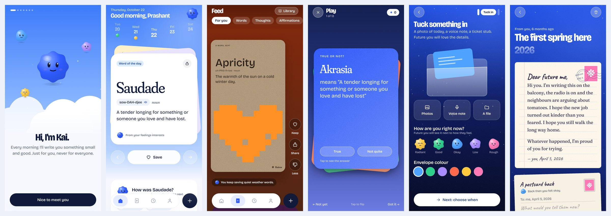
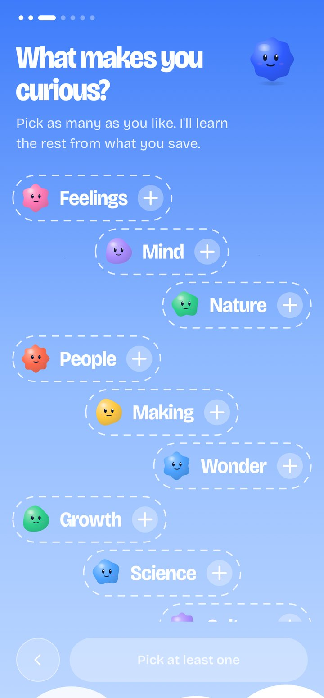
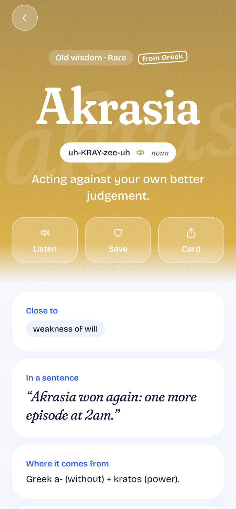
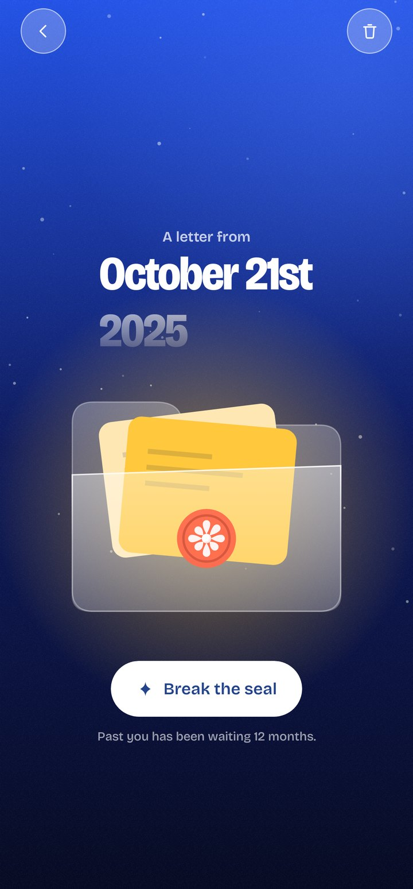
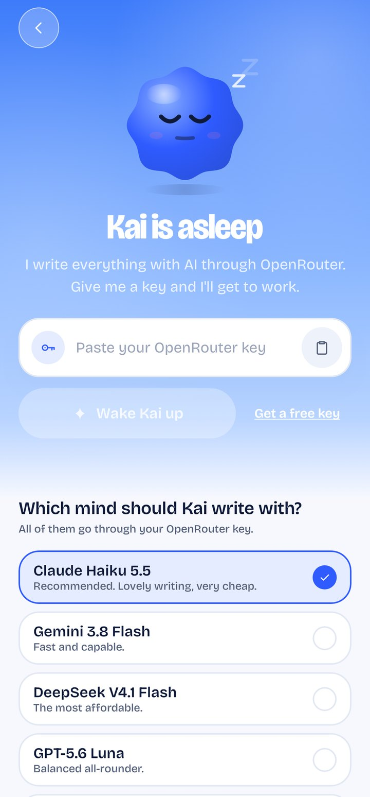
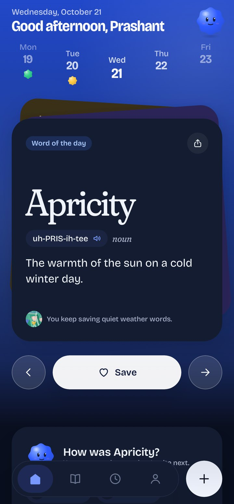
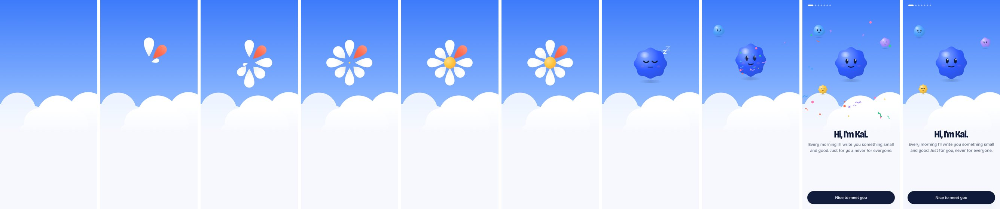
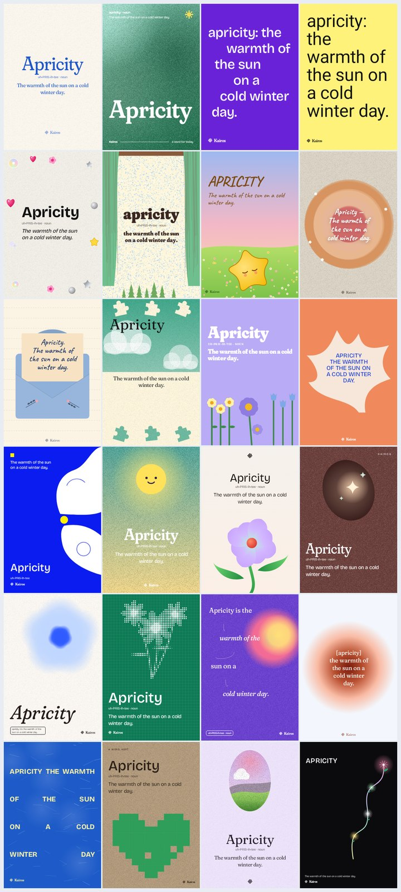
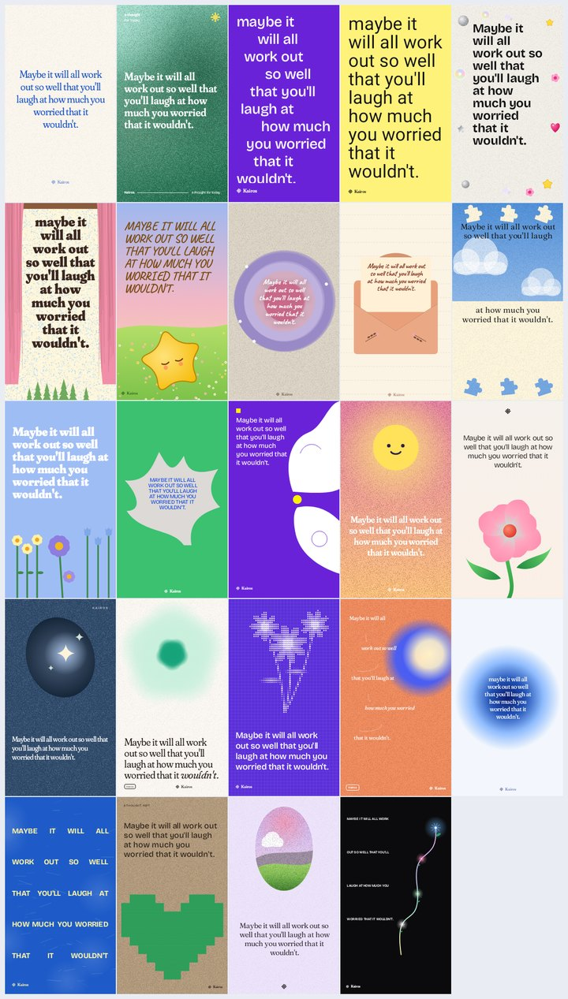

# Kairos

**A word, a thought and a small good thing, written for you every day.**

Kairos (καιρός) is Greek for *the right moment*. Each day it gives you one word worth knowing,
one thought worth keeping and one small good thing to do. All of it is written by an AI curator
that learns from what you save, skip and practise. There's also a time capsule for letters to
future you.

<p></p>

<p>





</p>

The onboarding wake-up, frame by frame: the bloom unfolds and becomes Kai.

<p></p>

Share cards, each drawn from one of the references in issue #606:

<p> </p>

## Kai writes for free (and offline on supported phones)

Kairos ships with its own AI so nobody has to bring a key: **Mercury 3** (Inception's diffusion
model, very fast) writes words, and **Gemini Flash** writes thoughts and books, where real quotes and
real books must be exactly right. Each falls back to the other. Anyone can still add their own
OpenRouter key under You → Kai, and it is used first. On phones that support it, **Gemini Nano**
runs on the device (ML Kit GenAI) and writes original lines, affirmations and small good things
offline; quotes, books and word origins always come from the cloud models.

The built-in keys are read at build time from `local.properties` or the environment
(`INCEPTION_API_KEY`, `GEMINI_API_KEY`) and are never committed. Anything inside an APK can be
extracted, so keep spending limits on these keys (or put a small proxy in front of them).

## Nothing is bundled: the curator writes everything

Kairos ships with **no word lists and no quote lists**. Every word, quote, small good thing and
capsule prompt is generated for one person, in real time, through [OpenRouter](https://openrouter.ai).
Each person adds their own key in the app (onboarding or You → Curator). It's encrypted on the
device and only ever sent to OpenRouter.

How the recommendation loop works:

1. **Signals.** Kairos records what you save, what you mark *too easy*, *too hard*, *more like this*
   or *not for me*, which words you keep forgetting in practice, which authors and themes you keep,
   your recent moods, your interests and level, and the time of day.
2. **Curator** (`engine/Curator.kt`). Turns those signals into a profile and asks the model
   (structured JSON output) for a batch of new words, quotes, small good things and prompts.
   Anything you've already seen goes into an "avoid" list.
3. **Validation.** Every item is checked before it's stored. Invented-looking words, definitions
   that use the word itself, missing fields, unknown categories, duplicates and bad attributions
   are dropped.
4. **Picker** (`engine/DailyEngine.kt`). Each day it chooses the best word and quote from your
   personal pool, deterministically, and says why it chose them ("You keep saving quiet weather
   words").
5. **Refill** (`work/RefillWorker`). A background job keeps a few unseen items ready, so Today
   opens instantly and works offline.
6. **Ask for words about…** in Learn generates a focused batch on any topic, live.

Three "too easy" votes in a row move your level up (and three "too hard" move it down). Saving a
word enrols it in SM-2 spaced repetition.

## Screens

| | |
|---|---|
| **Onboarding** | The logo wakes up: the bloom's petals unfold and it becomes Kai, the curator, who opens their eyes. Kai and three friends stay on screen and move between steps while a white cloud field rises and falls. Giant dashed-to-solid pills for topics and themes, a word wheel and adaptive slider for level, a key ritual to wake Kai, and an aurora finale that says what Kai learned about you. |
| **Today** | Greeting with Kai in today's mood, an arched week strip with a mood shape for each day, and a swipeable deck of tilted cards: the word, the thought and the small good thing. `←  Save  →` controls with a heart burst, Teach Kai reactions, a mood check-in through the adaptive slider (Kai changes shape as you slide), a review nudge and a peek at the capsule. |
| **Feed** | An endless reel of words, thoughts, affirmations, book bites and breathing pauses, each on its own card design. Double tap to keep, share to a card, "less" to see fewer. It learns from what you keep, share and linger on, and re-ranks as you scroll. |
| **Play** | Random flashcards: guess the word, finish the line, true or not. Flip, swipe right if you knew it. |
| **Library** | Words, Thoughts and Books. An endless, ranked "Fresh for you" strip, "Ask Kai for words about…", typographic library tiles, and micro-summaries of books on a shelf of typographic covers. |
| **Word / thought / book pages** | A typographic specimen hero for words (the word over a ghost of itself), a grainy glow with a smiling sun for thoughts, and a book page with the summary, key ideas and a line. |
| **Practice** | Grainy, deep-coloured flip cards fanned over each other with an orbit ring, petal progress, ✦ points, grade buttons with Kai's faces, and a garden at the end. |
| **Card studio** | Twenty-four share cards, each with its own layout for Pin, Story and Square,  drawn from the references (Note, Poster, Bold, Blunt, Stickers, Stage, Starry, Ring, Envelope, Split, Garden, Leaf, Swiss, Glow, Bloom, Portal), five hues, three formats, exported at 1080px. Text always fits its own zone, so nothing overlaps in any format. |
| **Time capsule** | A night sky with glass folders, letters peeking out and a mood sticker on each. Compose on cream paper with an "open in" slider; seal it and a wax bloom stamps it shut while dandelion seeds drift away; open it and the folder tips toward you and the letter slides out. |
| **You** | Kai, stats, your garden (a flower for every word you kept), four weeks of mood shapes, and settings with face toggles. |

## Design: playful sky

The redesign follows the references in issue #606 and the house skill
`.agents/skills/kairos-playful-sky`, which ranks those references above every external design skill.

- **Look:** a bright sky that melts into a cool white canvas, crisp glass, one cobalt action colour,
  and a candy set (sun, coral, bubblegum, mint, lilac, sky) for characters, tiles and celebrations.
  Grain over illustration. The capsule lives under a night sky.
- **Kai:** the curator has a face. Kai is a soft character whose outline is a polar function, so
  every mood (radiant, good, okay, low, rough) is a shape it can morph into. Kai blinks, breathes,
  sleeps without a key and reacts to what you do.
- **Type:** Bricolage Grotesque for the interface and the big playful headlines, Fraunces (soft and a
  little wonky) for words, quotes and letters.
- **Motion:** one signature spring with a little overshoot for characters and pop-ins, quick and quiet
  springs for navigation, and the celebrations saved for rare moments. *Calmer motion* (or the
  system animator scale) keeps expressions and fades but drops travel, bounce and particles.
- **Adaptive slider:** a row of bars that swell around a stretchy thumb and take the colour of the
  value, with a bubble whose content adapts (a word for the level, Kai's face for a mood, a date for a
  letter).
- **Logo:** the moment bloom, always in one colour: eight petals around a round centre, with the
  petal at one o'clock full length like a clock hand, because chronos is clock time and kairos is the
  one moment that matters. The icon is the white mark on deep cobalt.

## Building

```bash
./gradlew :app:assembleDebug                 # debug APK
./gradlew :app:testDebugUnitTest             # curator, OpenRouter client, SM-2, picker, screenshots
./gradlew :app:recordRoborazziDebug          # re-render screenshots into app/screenshots
```

Kotlin 2.0, Jetpack Compose, Room, DataStore, WorkManager, OkHttp, Haze, Coil and
security-crypto. All illustration (Kai, flowers, paintings, clouds, the bloom) is drawn in code. Min SDK 26, target 35. Dependencies are wired by hand in `KairosApp.kt`.

```
app/src/main/java/com/kairos/app/
  data/ai      OpenRouter client, encrypted key store
  data/db      Room entities and DAOs
  data/repo    KairosRepository (curator loop, today, feedback), CapsuleRepository
  engine/      Curator (prompt, schema, validation), DailyEngine, Srs, Mood, Topics
  work/        refill, daily reminder, capsule unlock, notifications
  ui/theme     palette, type, motion
  ui/art       Kai, the bloom, flowers, paintings, clouds, aurora, grain, bursts
  ui/components  design-system kit and icons
  ui/nav       shell, bottom bar, navigation
  ui/feature   today, learn, detail, practice, studio, capsule, you, onboarding
```
