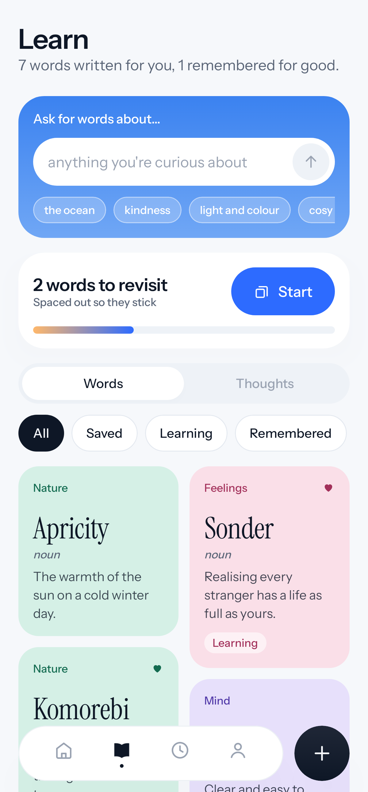
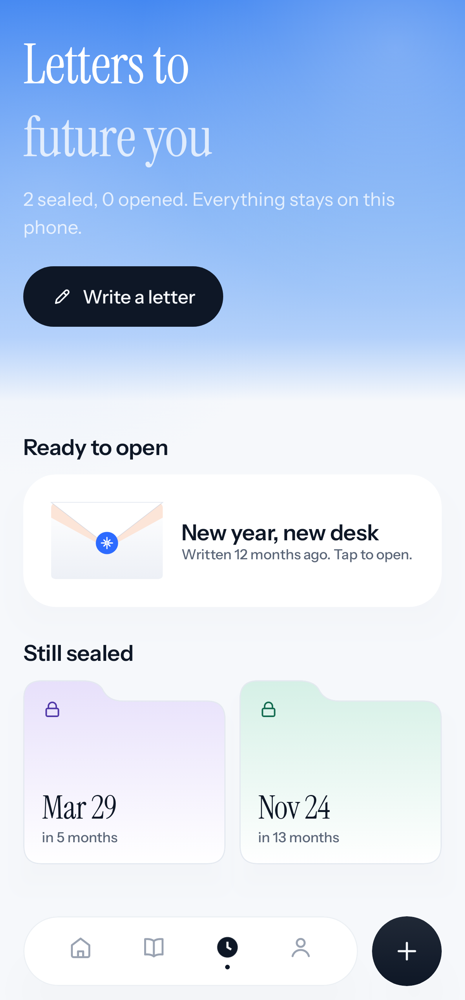
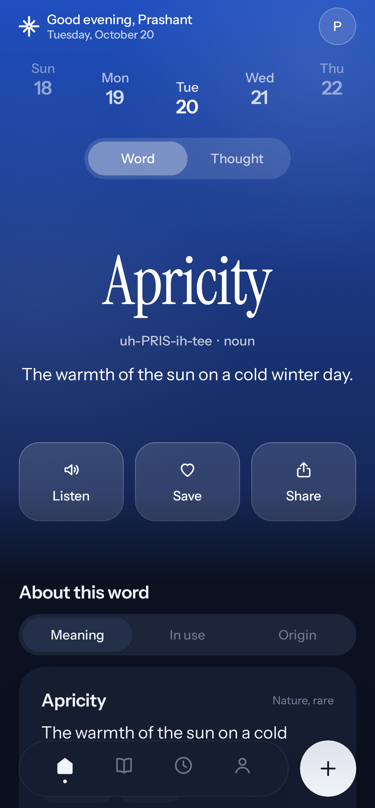

# Kairos

**A word, a thought and a small good thing, written for you every day.**

Kairos (καιρός) is Greek for *the right moment*. Each day it gives you one word worth knowing,
one thought worth keeping and one small good thing to do. All of it is written by an AI curator
that learns from what you save, skip and practise. There's also a time capsule for letters to
future you.

<p>




</p>

## Nothing is bundled: the curator writes everything

Kairos ships with **no word lists and no quote lists**. Every word, quote, small good thing and
capsule prompt is generated for one person, in real time, through [OpenRouter](https://openrouter.ai).
Each person adds their own key in the app (onboarding or You → Curator). It's encrypted on the
device and only ever sent to OpenRouter.

How the recommendation loop works:

1. **Signals.** Kairos records what you save, what you mark *too easy*, *too hard*, *more like this*
   or *not for me*, which words you keep forgetting in practice, which authors and themes you keep,
   your recent moods, your interests and level, and the time of day.
2. **Curator** (`engine/Curator.kt`). Turns those signals into a profile and asks the model
   (structured JSON output) for a batch of new words, quotes, small good things and prompts.
   Anything you've already seen goes into an "avoid" list.
3. **Validation.** Every item is checked before it's stored. Invented-looking words, definitions
   that use the word itself, missing fields, unknown categories, duplicates and bad attributions
   are dropped.
4. **Picker** (`engine/DailyEngine.kt`). Each day it chooses the best word and quote from your
   personal pool, deterministically, and says why it chose them ("You keep saving quiet weather
   words").
5. **Refill** (`work/RefillWorker`). A background job keeps a few unseen items ready, so Today
   opens instantly and works offline.
6. **Ask for words about…** in Learn generates a focused batch on any topic, live.

Three "too easy" votes in a row move your level up (and three "too hard" move it down). Saving a
word enrols it in SM-2 spaced repetition.

## Screens

| | |
|---|---|
| **Today** | A sky hero with today's word or thought in large serif, glass actions (listen, save, share), an arched week strip, meaning / in use / origin, feedback for the curator, a mood check-in, a small good thing, a review nudge and your next capsule letter. |
| **Learn** | "Ask for words about…", a review banner, and a two-column board of pastel word tiles (tinted by topic) and quote tiles. |
| **Word / thought pages** | Everything about one item, with feedback controls. |
| **Practice** | 3D flip cards and quick quizzes graded with SM-2. |
| **Card studio** | Five editorial share-card templates (Sky, Paper, Note, Night, Glass), five hues and three formats, exported at 1080px. |
| **Time capsule** | Letters with photos, videos, files and voice notes, sealed until a chosen day, with a live countdown, an unlock notification, a seal-breaking animation and a reply to past you. |
| **You** | Stats, four weeks of moods, recent good moments, and settings: curator, interests and level, reminder, motion and appearance. |

## Design: airy sky glass

- **Look:** a sky-blue hero that fades into a quiet white canvas, crisp frosted glass and one
  cobalt accent. Pastels appear only as tile tints.
- **Type:** Instrument Sans for the interface, Instrument Serif for words and quotes.
- **Navigation:** a minimal bottom bar with a dark "+" for quick actions.
- **Motion:** one spring family, shared-element word transitions, 3D card flips and envelope
  animations. *Calmer motion* (or the system animator scale) turns them down.
- **Logo:** an eight-ray mark, a moment opening up.

## Building

```bash
./gradlew :app:assembleDebug                 # debug APK
./gradlew :app:testDebugUnitTest             # 37 tests: curator, OpenRouter client, SM-2, picker, screenshots
./gradlew :app:recordRoborazziDebug          # re-render screenshots into app/screenshots
```

Kotlin 2.0, Jetpack Compose, Room, DataStore, WorkManager, OkHttp, Haze, Coil and
security-crypto. Min SDK 26, target 35. Dependencies are wired by hand in `KairosApp.kt`.

```
app/src/main/java/com/kairos/app/
  data/ai      OpenRouter client, encrypted key store
  data/db      Room entities and DAOs
  data/repo    KairosRepository (curator loop, today, feedback), CapsuleRepository
  engine/      Curator (prompt, schema, validation), DailyEngine, Srs, Mood, Topics
  work/        refill, daily reminder, capsule unlock, notifications
  ui/theme     palette, type, motion
  ui/components  design-system kit and icons
  ui/nav       shell, bottom bar, navigation
  ui/feature   today, learn, detail, practice, studio, capsule, you, onboarding
```
