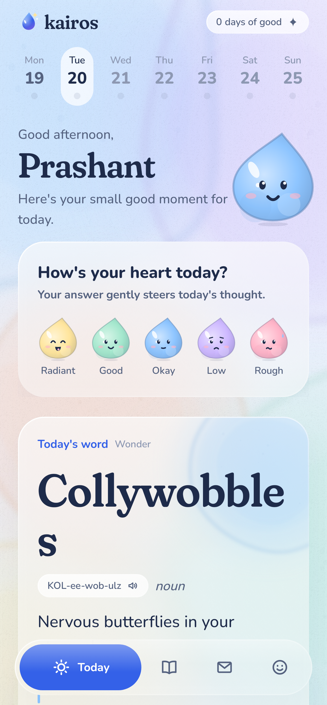
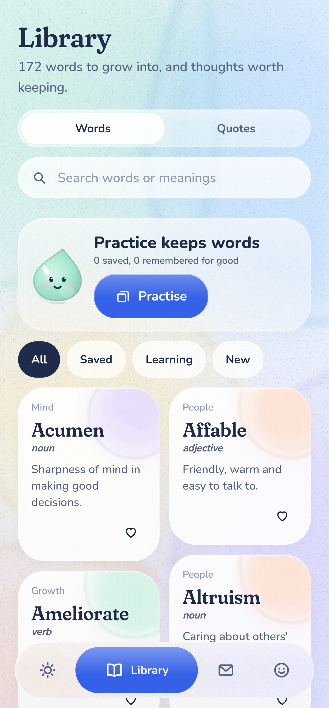
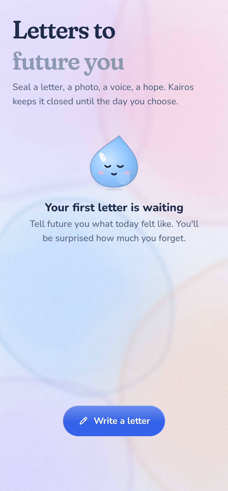
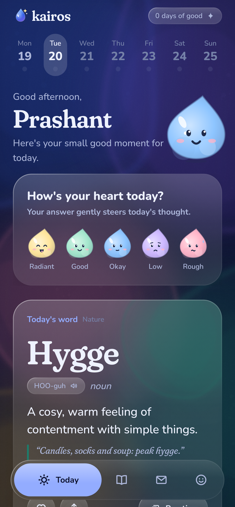

# Kairos

**A small good moment, every day.**

Kairos (καιρός) is the Greek word for *the opportune moment*. The app gives you one lovely word,
one thought worth keeping and one tiny good thing to do each day, plus a time capsule for
letters to future you. It's local-first: no account, no ads, nothing leaves your phone.

<p>




</p>

## What's inside

| | |
|---|---|
| **Today** | A word and a quote chosen for you, a mood check-in that steers the quote, a "tiny good thing" to try, and a peek at your next capsule letter. |
| **Library** | A Pinterest-style board of 172 hand-written words (pronunciation, origin, examples, close cousins) and 111 quotes. Search, filter, save. |
| **Practice** | Flip cards and quick quizzes scheduled with SM-2 spaced repetition, so words come back right before you'd forget them. |
| **Card studio** | Turn any word or quote into a painted share card: 6 styles, 5 palettes, Pin/Story/Square, exported at 1080px with the Kairos postmark. |
| **Time capsule** | Handwritten letters with photos, videos, files and voice notes, sealed with wax until a day you choose. A live countdown, a notification on the day, a seal-breaking animation, and a place to write back. |
| **Me** | The joy jar (every good moment becomes a paint drop, with no streaks to lose), a four-week mood garden, everything you kept, and settings. |
| **Drop** | The mascot: a watercolour water-drop who blinks, bobs, giggles when poked and wears your mood. |

## How the engine picks things

`engine/DailyEngine.kt` is deterministic and explains itself. The same day, install salt and history
always give the same pick, and every pick carries a reason ("From your wonder interests",
"For a low day").

- **Words** score on your chosen interests, the categories of words you've saved, how close they are to your
  level, and freshness. A word that's been shown recently is skipped for 120 days.
- **Quotes** score on today's mood, your themes, the themes you save most and the time of day. Quotes have
  a 60-day cooldown, and "Another" re-picks without repeating.
- **Sparks** rotate through the whole set before any repeats.
- **Saving a word** enrols it in spaced repetition. Saving is taste; grading is memory.

## Design system

- **Look:** liquid glass over a living acrylic-watercolour paper, with cute 2D characters.
- **Watercolour:** painted procedurally (`ui/paint/Watercolor.kt`): layered glazes, soft pigment rims,
  granulation and paper grain. The pools drift slowly and re-tint per screen.
- **Glass:** real backdrop blur via [Haze](https://github.com/chrisbanes/haze) on Android 12L+, with a
  frosted tint fallback, a caustic sheen and a bevelled rim.
- **Type:** Fraunces (soft, wonky serif) for words and quotes, Nunito (rounded) for interface text,
  and Caveat (handwriting) for capsule letters.
- **Colour:** cobalt ink with cerulean, lilac, peach, mint, butter and rose washes, plus a separate
  *Dusk* dark palette.
- **Icons:** a custom 1.9dp rounded set (`ui/icons/KairosIcons.kt`).
- **Motion:** one spring family. Squish on touch, a gooey liquid tab indicator, shared-element word
  transitions and 3D card flips. A "Calmer motion" setting (and the system animator scale) turns it all down.

## Building

```bash
./gradlew :app:assembleDebug          # debug APK
./gradlew :app:testDebugUnitTest      # engine tests + screenshot tests
./gradlew :app:recordRoborazziDebug   # re-record screenshots into app/screenshots
```

Kotlin 2.0, Jetpack Compose (BOM 2024.12), Room, DataStore, WorkManager, Coil and Haze. Min SDK 26,
target 35. There's no DI framework: `AppContainer` in `KairosApp.kt` wires everything by hand.

```
app/src/main/java/com/kairos/app/
  data/        Room entities & DAOs, DataStore settings, bundled content loader, repositories
  engine/      DailyEngine (picks), Srs (SM-2), Mood
  work/        daily reminder + capsule unlock workers, notifications
  ui/theme     palette, type scale, radii/spacing, motion
  ui/paint     procedural watercolour
  ui/glass     liquid glass
  ui/mascot    Drop
  ui/brand     logo, wordmark, postmark stamp
  ui/screens   today, words, practice, studio, capsule, me, onboarding, settings
```

Content lives in `app/src/main/assets/content/*.json`. Bump `ContentLoader.VERSION` after editing it;
new rows are added and existing progress is kept.
